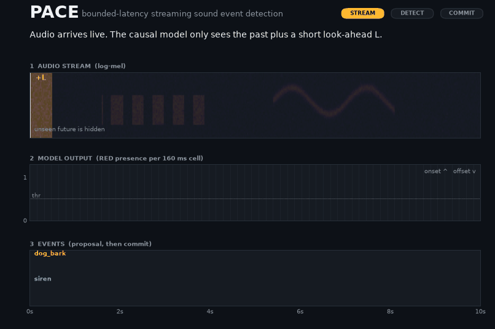

# PACE

PACE studies what a **causal** sound event detector loses against a
**bidirectional** one, and how much of that loss a bounded amount of future
audio recovers. The models are CRNNs trained on URBAN-SED and scored with
sed_eval segment F; the code also supports TUT 2017, DESED and
AudioSet-Strong through the same feature-cache interface.

What the repository provides:

- a causal CRNN backbone with a configurable look-ahead (`lookahead_frames`)
  and a bidirectional reference of matched size;
- a limited-future GRU (`context: gru_lc`) that gives each cell a fixed window
  of future cells;
- frame-wise, one-pass and RED + onset/offset + event-proposal heads;
- a per-cell streaming replay that measures commit delay and events still open
  at the end of the window;
- segment F/ER, event-F1 and PSDS1/PSDS2 metrics, and params/MACs/latency
  profiling.

Start with [Getting started](getting-started.md).

## Credits

The one-pass detector this work builds on is by Venkatesh, Moffat and Miranda
(*Applied Sciences* 12(7), 3293, 2022; MIT-licensed code). The URBAN-SED data
belongs to its original authors.
